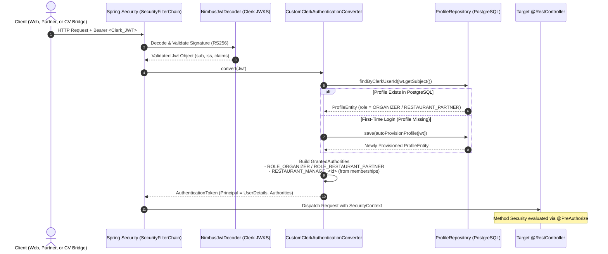
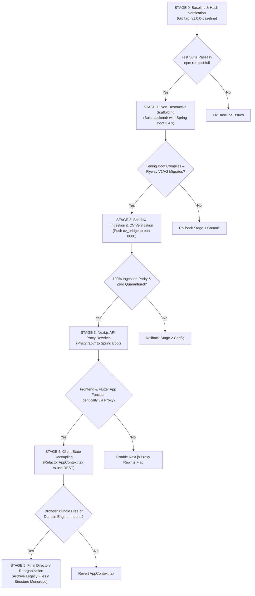

# JUNCTION — Complete Project Structure Audit & Organization Specification

**Document Version:** 2.0.0 (Corrected & Expanded Post-Audit)  
**Repository:** `Junction-App` (`junction-app` v0.1.0)  
**Analysis Date:** November 2026  
**Auditor:** Antigravity Engineering Architecture Analysis  
**Scope:** Complete structural audit of all files, directories, dependencies, security boundaries, and migration pathways.

---

## Executive Summary & Key Audit Findings

This document is the authoritative structural audit of the **JUNCTION** repository. Every directory, file, dependency, configuration, and data flow has been directly verified against the active codebase.

> [!IMPORTANT]
> ### Crucial Architectural Corrections Applied in Version 2.0.0
> 1. **Next.js 16 Proxy Convention (`src/proxy.ts`):** In Next.js 16, the legacy `middleware.ts` file convention is **officially deprecated** and replaced by `proxy.ts` (see `node_modules/next/dist/docs/01-app/03-api-reference/03-file-conventions/proxy.md`). For projects utilizing the `src` directory, `proxy.ts` must reside at the same level as `src/app/`, meaning **`src/proxy.ts` is the single authoritative proxy file**. It must **not** be renamed to `middleware.ts`. The file in the repository root (`c:\Github\Junction-App\proxy.ts`) is an extraneous root duplicate.
> 2. **Spring Boot Version Recommendation (3.4.x GA over 3.3.x):** While Spring Boot 3.3.x was initially evaluated, **Spring Boot 3.4.x** (specifically 3.4.0+ GA) is the recommended target for Java 21 LTS migration. Spring Boot 3.4 incorporates Spring Framework 6.2, hardened Virtual Threads support, native structured logging, Hibernate 6.6, and Flyway 10, with active open-source support extending through late 2025. Spring Boot 4.x is currently unreleased and pre-GA.
> 3. **Validation of `AppContext.tsx` Coupling:** Inspection of `src/state/AppContext.tsx` confirms that the client browser executes the full domain simulation, sensor stream generation, LRU deduplication, sensor fusion, spatial cascade analysis, and recommendation generation in-browser, bypassing the server-side REST API routes.
> 4. **Staged Reversible Migration Strategy:** The concept of "zero-risk cleanup" has been eliminated and replaced by a strictly gated, 5-stage reversible migration plan with rollback checkpoints.

---

## 1. Classification of Knowledge & Audit Conventions

To maintain strict architectural rigor, all statements in this document are tagged under three categories:
- **`[VERIFIED IMPLEMENTATION FACT]`**: Directly verified from source code, directory structures, git stages, configuration files, and line numbers.
- **`[ARCHITECTURAL RECOMMENDATION]`**: Proven target-state enterprise patterns designed for Java Spring Boot and decoupled Next.js.
- **`[NEEDS FURTHER VERIFICATION / OPEN QUESTION]`**: Items requiring runtime verification, operator confirmation, or production secret inspection.

---

## 2. Complete Repository File Inventory

### 2.1 File Categorization (Tracked, Untracked, and Generated)

```text
Repository File Totals:
├── Tracked in Git:      423 files
├── Untracked / New:     3 files (BACKEND_DOCUMENTATION.md, PROJECT_STRUCTURE.md, MIGRATION_READINESS_REPORT.md)
└── Generated / Ignored: node_modules/, .next/, __pycache__/, public/cesium/
```

### 2.2 Complete Repository Tree

```text
C:\Github\Junction-App\
│
├── [CONFIG & REPO ROOT]
│   ├── .dockerignore                         # [VERIFIED IMPLEMENTATION FACT] Exclusions for Docker daemon
│   ├── .env                                  # [VERIFIED IMPLEMENTATION FACT] Local dev environment variables
│   ├── .gitignore                            # [VERIFIED IMPLEMENTATION FACT] Git ignore patterns
│   ├── AGENTS.md                             # [VERIFIED IMPLEMENTATION FACT] Agentic coding rules & Next.js 16 alerts
│   ├── BACKEND_DOCUMENTATION.md              # [UNTRACKED] Complete backend technical documentation
│   ├── CLAUDE.md                             # [VERIFIED IMPLEMENTATION FACT] Assistant instructions
│   ├── DEPLOYMENT_GUIDE.md                   # [VERIFIED IMPLEMENTATION FACT] Railway & APK install guide
│   ├── Dockerfile                            # [VERIFIED IMPLEMENTATION FACT] Multi-stage production container definition
│   ├── drizzle.config.ts                     # [VERIFIED IMPLEMENTATION FACT] Drizzle ORM schema mapping config
│   ├── generate_qr.js                        # [VERIFIED IMPLEMENTATION FACT] QR generation utility
│   ├── implementation_plan_v2.md             # [VERIFIED IMPLEMENTATION FACT] Master implementation roadmap
│   ├── MIGRATION_READINESS_REPORT.md         # [UNTRACKED] Dedicated migration readiness analysis
│   ├── next.config.ts                        # [VERIFIED IMPLEMENTATION FACT] Next.js 16 configuration
│   ├── package-lock.json                     # [VERIFIED IMPLEMENTATION FACT] NPM exact dependency tree
│   ├── package.json                          # [VERIFIED IMPLEMENTATION FACT] NPM manifest & project scripts
│   ├── PROJECT_STRUCTURE.md                  # [UNTRACKED] Complete project structure audit (This document)
│   ├── proxy.ts                              # [VERIFIED IMPLEMENTATION FACT] Root duplicate proxy file
│   ├── pytest.ini                            # [VERIFIED IMPLEMENTATION FACT] Python test runner configuration
│   ├── railway.json                          # [VERIFIED IMPLEMENTATION FACT] Railway container deployment spec
│   ├── README.md                             # [VERIFIED IMPLEMENTATION FACT] Public landing overview
│   └── tsconfig.json                         # [VERIFIED IMPLEMENTATION FACT] TypeScript compiler config
│
├── .claude/
│   └── rules/
│       └── rocketride.md                     # [VERIFIED IMPLEMENTATION FACT] Assistant rules for RocketRide
│
├── .github/
│   └── workflows/
│       └── release.yml                       # [VERIFIED IMPLEMENTATION FACT] GitHub Action publishing APK on v* tags
│
├── .rocketride/                              # [VERIFIED IMPLEMENTATION FACT] RocketRide Tool Schemas (102 files)
│   └── schema/
│       ├── accessibility_describe.json
│       ├── agent_crewai.json
│       ├── agent_crewai_manager.json
│       ├── agent_crewai_subagent.json
│       ├── agent_deepagent.json
│       ├── agent_deepagent_subagent.json
│       ├── agent_langchain.json
│       ├── agent_rocketride.json
│       ├── anonymize_text.json
│       ├── astra_db.json
│       ├── audio_player.json
│       ├── audio_transcribe.json
│       ├── audio_tts.json
│       ├── chat.json
│       ├── chroma.json
│       ├── db_clickhouse.json
│       ├── db_mysql.json
│       ├── db_neo4j.json
│       ├── db_postgres.json
│       ├── db_supabase.json
│       ├── dictionary.json
│       ├── dropper.json
│       ├── elasticsearch.json
│       ├── embedding_image.json
│       ├── embedding_openai.json
│       ├── embedding_transformer.json
│       ├── embedding_video.json
│       ├── extract_data.json
│       ├── filesys.json
│       ├── frame_grabber.json
│       ├── guardrails.json
│       ├── hash.json
│       ├── image_cleanup.json
│       ├── image_vision_gemini.json
│       ├── image_vision_mistral.json
│       ├── image_vision_ollama.json
│       ├── image_vision_openai.json
│       ├── llamaparse.json
│       ├── llm_anthropic.json
│       ├── llm_bedrock.json
│       ├── llm_deepseek.json
│       ├── llm_gemini.json
│       ├── llm_gmi_cloud.json
│       ├── llm_minimax.json
│       ├── llm_mistral.json
│       ├── llm_nebius.json
│       ├── llm_ollama.json
│       ├── llm_openai.json
│       ├── llm_openai_api.json
│       ├── llm_perplexity.json
│       ├── llm_qwen.json
│       ├── llm_xai.json
│       ├── local-text-output.json
│       ├── mcp_client.json
│       ├── memory_internal.json
│       ├── memory_persistent.json
│       ├── milvus.json
│       ├── mongodb%2Bsrv.json
│       ├── ner.json
│       ├── ocr.json
│       ├── opensearch.json
│       ├── parse.json
│       ├── pinecone.json
│       ├── postgres.json
│       ├── preprocessor_code.json
│       ├── preprocessor_langchain.json
│       ├── preprocessor_llm.json
│       ├── prompt.json
│       ├── qdrant.json
│       ├── question.json
│       ├── reducto.json
│       ├── remote.json
│       ├── rerank_cohere.json
│       ├── response_answers.json
│       ├── response_audio.json
│       ├── response_documents.json
│       ├── response_image.json
│       ├── response_questions.json
│       ├── response_table.json
│       ├── response_text.json
│       ├── response_video.json
│       ├── search_exa.json
│       ├── summarization.json
│       ├── telegram.json
│       ├── text-output.json
│       ├── thumbnail.json
│       ├── tool_bland_ai.json
│       ├── tool_butterbase.json
│       ├── tool_chartjs.json
│       ├── tool_exa_search.json
│       ├── tool_filesystem.json
│       ├── tool_firecrawl.json
│       ├── tool_git.json
│       ├── tool_github.json
│       ├── tool_http_request.json
│       ├── tool_pipe.json
│       ├── tool_python.json
│       ├── tool_tavily.json
│       ├── tool_xtrace_memory.json
│       ├── twelvelabs.json
│       ├── weaviate.json
│       └── webhook.json
│
├── artifacts/                                # [GENERATED OUTPUT / COMMITTED]
│   ├── annotated_demo.mp4
│   ├── annotated_venue_entrance_validation.mp4
│   ├── observations.jsonl
│   └── venue_entrance_observations.jsonl
│
├── assets/                                   # [VERIFIED IMPLEMENTATION FACT] Video assets (Duplicate of public/videos)
│   ├── 15546948_1080_1920_50fps.mp4
│   ├── 30744-382777820.mp4
│   ├── 6387-191695740_medium.mp4
│   ├── demo_cctv.mp4
│   └── venue_entrance_validation.mp4
│
├── attendee_flutter_app/                     # [VERIFIED IMPLEMENTATION FACT] Cross-Platform Mobile Client
│   ├── pubspec.yaml
│   ├── android/
│   │   ├── app/build.gradle
│   │   ├── app/src/main/AndroidManifest.xml
│   │   └── build.gradle
│   ├── ios/
│   │   ├── Runner/Info.plist
│   │   └── Runner.xcodeproj
│   ├── lib/
│   │   ├── main.dart                         # Flutter application entry point
│   │   ├── data/
│   │   │   └── mock_data.dart
│   │   ├── models/
│   │   │   ├── map_destination.dart
│   │   │   ├── multimodal_route.dart
│   │   │   ├── navigation_step.dart
│   │   │   ├── route_option.dart
│   │   │   └── types.dart
│   │   ├── screens/
│   │   │   ├── auth_screen.dart
│   │   │   ├── destination_route_screen.dart
│   │   │   ├── event_screen.dart
│   │   │   ├── food_screen.dart
│   │   │   ├── home_screen.dart
│   │   │   ├── main_shell.dart
│   │   │   ├── plan_screen.dart
│   │   │   ├── splash_screen.dart
│   │   │   └── stay_screen.dart
│   │   ├── services/
│   │   │   ├── backend_scenario_sync_service.dart # Connects to /api/scenarios
│   │   │   ├── crowd_routing_service.dart
│   │   │   ├── location_service.dart
│   │   │   ├── maps_launcher.dart
│   │   │   ├── navigation_service.dart
│   │   │   ├── navigation_voice_service.dart
│   │   │   ├── osm_road_network.dart
│   │   │   ├── routing_service.dart
│   │   │   ├── scenario_intelligence_service.dart
│   │   │   └── transit_routing_service.dart
│   │   ├── state/
│   │   │   └── app_state.dart
│   │   ├── theme/
│   │   │   └── app_theme.dart
│   │   └── widgets/
│   │       ├── app_header.dart
│   │       ├── bottom_nav_bar.dart
│   │       ├── junction_brand_emblem.dart
│   │       ├── motion_tap.dart
│   │       ├── pill_badge.dart
│   │       ├── pressure_bar.dart
│   │       ├── profile_modal.dart
│   │       ├── route_transit_map.dart
│   │       ├── simulated_watermark.dart
│   │       └── travel_mode_selector.dart
│   ├── test/
│   │   └── widget_test.dart
│   └── web/
│       ├── index.html
│       └── manifest.json
│
├── cv_bridge/                                # [VERIFIED IMPLEMENTATION FACT] Python Computer Vision Subsystem
│   ├── config.example.json                   # Sample calibration configuration
│   ├── inference.py                          # YOLOv12 + ByteTrack inference CLI
│   ├── metrics.py                            # Density, centroid & tripwire mathematical formulas
│   ├── observation_serializer.py             # Canonical NormalizedObservation JSON serializer
│   ├── README.md                             # Pipeline instructions & privacy governance rules
│   ├── requirements.txt                      # PyTorch, Ultralytics, OpenCV dependencies
│   ├── transport.py                          # HTTP POST and JSONL emission client
│   ├── yolo_compat.py                        # Compatibility patch for YOLOv12 architecture
│   └── tests/
│       ├── test_metrics.py                   # Pytest suite for centroid and line intersection
│       └── test_serializer.py                # Pytest suite for schema validation
│
├── docs/                                     # [VERIFIED IMPLEMENTATION FACT] Project Documentation
│   ├── decision-log.md
│   ├── JUNCTION_Production_System_Implementation_Blueprint.md
│   ├── JUNCTION_PS8_Alignment_Analysis.md
│   ├── logo.png
│   └── third-party-models.md
│
├── models/                                   # [VERIFIED IMPLEMENTATION FACT] Deep Learning Model Weights
│   ├── README.md
│   ├── yolov12m.pt                           # YOLOv12 Medium weights (~40 MB)
│   └── yolov12n.pt                           # YOLOv12 Nano weights (~6 MB)
│
├── public/                                   # [VERIFIED IMPLEMENTATION FACT] Static Assets
│   ├── file.svg
│   ├── globe.svg
│   ├── hero_editorial.png
│   ├── hero_illustration.png
│   ├── junction-attendee.apk                 # Compiled Android APK (53 MB)
│   ├── junction-qr.png
│   ├── junction_hero.png
│   ├── logo.png
│   ├── manifest.json
│   ├── next.svg
│   ├── vercel.svg
│   ├── window.svg
│   ├── cesium/                               # [GENERATED VIA POSTINSTALL] 3D CesiumJS WebGL Assets
│   │   ├── Cesium.js
│   │   ├── index.cjs
│   │   ├── index.js
│   │   ├── Assets/                           # Terrain textures, shaders & heightmaps
│   │   ├── ThirdParty/                       # WebGL worker dependencies
│   │   ├── Widgets/                          # Cesium CSS & UI widgets
│   │   └── Workers/                          # Background geometry web workers
│   └── videos/                               # Demo & validation video streams
│       ├── 15546948_1080_1920_50fps.mp4
│       ├── 30744-382777820.mp4
│       ├── 6387-191695740_medium.mp4
│       ├── annotated_concourse.mp4
│       ├── annotated_demo.mp4
│       ├── annotated_marine_lines.mp4
│       ├── annotated_staging.mp4
│       ├── annotated_venue_entrance_validation.mp4
│       ├── demo_cctv.mp4
│       └── venue_entrance_validation.mp4
│
├── scratch/                                  # [VERIFIED IMPLEMENTATION FACT] Ad-Hoc Developer Scripts
│   ├── analyze_validation_run.py
│   ├── comprehensive_fusion_test.ts
│   ├── e2e_scenario_validation.ts
│   ├── generate_test_video.py
│   ├── generate_venue_entrance_video.py
│   ├── test_cv_to_fusion_e2e.ts
│   └── test_input_and_comparison.ts
│
├── scripts/                                  # [VERIFIED IMPLEMENTATION FACT] Canonical Test Harnesses
│   ├── test-full-system.ts                   # 5-suite master integration test
│   └── test-input-system.ts                  # Modality provider verification script
│
└── src/                                      # [VERIFIED IMPLEMENTATION FACT] Next.js 16 Application Root
    ├── proxy.ts                              # [VERIFIED IMPLEMENTATION FACT] Official Next.js 16 Proxy File
    ├── app/                                  # Next.js App Router Structure
    │   ├── favicon.ico
    │   ├── globals.css
    │   ├── landing.module.css
    │   ├── layout.tsx                        # Root layout wrapping application with Clerk & state
    │   ├── page.module.css
    │   ├── page.tsx                          # Landing page
    │   ├── api/                              # REGISTERED HTTP ENDPOINTS
    │   │   ├── audit/route.ts                # GET /api/audit
    │   │   ├── auth/me/route.ts              # GET /api/auth/me
    │   │   ├── health/route.ts               # GET /api/health
    │   │   ├── hotspots/route.ts             # GET /api/hotspots
    │   │   ├── observations/route.ts         # GET, POST /api/observations
    │   │   ├── partner/inventory/route.ts    # POST /api/partner/inventory
    │   │   ├── predictions/route.ts          # GET /api/predictions
    │   │   ├── recommendations/route.ts      # GET /api/recommendations
    │   │   ├── recommendations/[id]/approve/route.ts # POST /api/recommendations/[id]/approve
    │   │   ├── recommendations/[id]/reject/route.ts  # POST /api/recommendations/[id]/reject
    │   │   ├── scenarios/route.ts            # GET, POST, OPTIONS /api/scenarios
    │   │   ├── zones/route.ts                # GET /api/zones
    │   │   └── zones/[zoneId]/route.ts       # GET /api/zones/[zoneId]
    │   ├── attendee/                         # Attendee Experience Portal
    │   │   ├── attendee.module.css
    │   │   ├── home.module.css
    │   │   ├── layout.tsx
    │   │   ├── page.tsx
    │   │   ├── showcase.module.css
    │   │   ├── event/page.tsx
    │   │   ├── food/page.tsx
    │   │   ├── plan/page.tsx
    │   │   └── stay/page.tsx
    │   ├── login/                            # Role-based Clerk Sign-In
    │   │   ├── page.tsx
    │   │   ├── organizer/[[...organizer]]/page.tsx
    │   │   └── restaurant/[[...restaurant]]/page.tsx
    │   ├── organizer/                        # Organizer Command Console
    │   │   ├── layout.tsx
    │   │   ├── page.tsx
    │   │   ├── capacity/page.tsx
    │   │   ├── cctv-demo/page.tsx
    │   │   ├── event/page.tsx
    │   │   ├── map/page.tsx
    │   │   ├── predictions/page.tsx
    │   │   ├── recommendations/page.tsx
    │   │   └── simulation/page.tsx
    │   ├── partner/                          # Partner Management Portal
    │   │   ├── layout.tsx
    │   │   └── page.tsx
    │   ├── sign-in/[[...sign-in]]/page.tsx
    │   └── sign-up/[[...sign-up]]/page.tsx
    ├── components/                           # UI Presentation Components
    │   ├── organizer/
    │   │   ├── ActionDrawer.tsx
    │   │   ├── CctvWidget.tsx
    │   │   ├── DestinationMap.tsx            # Multi-provider map container
    │   │   ├── ResourcePanel.tsx
    │   │   ├── SimulationDrawer.tsx
    │   │   ├── ZoneDrawer.tsx
    │   │   ├── ZoneInputEvidencePanel.tsx
    │   │   ├── cctv/
    │   │   │   ├── CctvFeedTableView.tsx
    │   │   │   ├── CctvOperationalActions.tsx
    │   │   │   ├── CctvTechnicalPanel.tsx
    │   │   │   └── CctvVideoFeedCard.tsx
    │   │   └── map/
    │   │       ├── CesiumCommandMap.tsx      # 3D Cesium globe
    │   │       ├── geoLayers.ts
    │   │       ├── InvestigationMap.tsx      # Legacy MapLibre crime view
    │   │       ├── LeafletCommandMap.tsx     # 2D Leaflet interactive map
    │   │       ├── MapLibreCommandMap.tsx    # MapLibre vector map
    │   │       ├── terrain.ts
    │   │       ├── WankhedeHoloDigitalTwin.tsx# Three.js 3D stadium twin
    │   │       └── layers/                   # MapLibre spatial layers (11 files)
    │   │           ├── AccommodationLayer.tsx
    │   │           ├── Cesium3DCityLayer.ts
    │   │           ├── HumanDensityLayer.tsx
    │   │           ├── HumanFlowLayer.tsx
    │   │           ├── OperationalNodeLayer.tsx
    │   │           ├── PredictedHotspotLayer.tsx
    │   │           ├── RestaurantLayer.tsx
    │   │           ├── RoadLayer.tsx
    │   │           ├── SensorHealthLayer.tsx
    │   │           ├── TransportLayer.tsx
    │   │           └── VenueLayer.tsx
    │   └── ui/
    │       ├── ConfidenceBadge.tsx
    │       ├── KPICard.tsx
    │       ├── PageHeader.tsx
    │       └── PressureIndicator.tsx
    ├── data/                                 # Static Cartographic & Baseline Fixtures
    │   ├── cases.ts                          # Residual crime investigation data
    │   ├── cctvFeeds.ts                      # Deployed camera registry
    │   ├── mockAlerts.ts
    │   ├── mockCrowdFlows.ts
    │   ├── mockEvent.ts
    │   ├── mockHotels.ts
    │   ├── mockHotspotService.ts             # Misplaced calculation function
    │   ├── mockNetworkTopology.ts
    │   ├── mockPredictions.ts
    │   ├── mockRecommendations.ts
    │   ├── mockResources.ts
    │   ├── mockRestaurants.ts
    │   ├── mockRoadNetwork.ts
    │   ├── mockRoutes.ts
    │   ├── mockScenarios.ts
    │   ├── mockTransportData.ts
    │   ├── mockUsers.ts                      # Demo login accounts
    │   ├── osmRoadNetwork.ts
    │   ├── prototypeCase.ts                  # Residual crime investigation fixtures
    │   ├── wankhedeSpatialGraph.ts
    │   └── map/
    │       ├── elevation.json
    │       └── maharashtra.json
    ├── db/                                   # Relational PostgreSQL Database Layer
    │   ├── index.ts                          # pg.Pool & Drizzle instance initialization
    │   ├── migrate.ts                        # DDL migration script
    │   ├── schema.ts                         # PostgreSQL schema definitions & Drizzle types
    │   └── seedDevData.ts                    # Baseline developer profile & restaurant seed
    ├── lib/
    │   └── clerkTheme.ts                     # Clerk UI theme styling
    ├── services/                             # Core Domain Intelligence Services (15 files)
    │   ├── authService.ts                    # PostgreSQL profiles, memberships, Clerk synchronization
    │   ├── canonicalRouteStore.ts            # Approved route detour corridors
    │   ├── deviceRegistry.ts                 # In-memory hardware device registry
    │   ├── eventLogger.ts                    # Structured diagnostic event logging
    │   ├── forecastingService.ts             # 15/30/45/60m predictive modeling engine
    │   ├── hospitalityDemandService.ts       # Surge demand propagation & commercial vouchers
    │   ├── hotspotAndCascadeEngine.ts        # Choke point detection & network propagation graph
    │   ├── index.ts                          # Barrel export
    │   ├── ingestionPipeline.ts              # LRU deduplication, schema validation & freshness
    │   ├── mockDataService.ts                # Scenario-driven baseline resource resolver
    │   ├── persistenceService.ts             # Dual-mode persistence (Postgres / In-Memory)
    │   ├── recommendationLifecycleEngine.ts  # Decision state machine & 5m duplicate cooldowns
    │   ├── routingEngine.ts                  # OpenStreetMap Dijkstra shortest-path solver
    │   ├── sensorFusionEngine.ts             # Weighted multi-modal sensor fusion math
    │   ├── sensorStreamSimulator.ts          # Synthetic telemetry generator for MVP testing
    │   ├── simulationEngine.ts               # Discrete cohort egress flow simulation
    │   ├── syntheticCVProvider.ts            # Synthetic computer vision adapter
    │   ├── transportSimulationEngine.ts      # Transit hub passenger boarding & taxi clearance
    │   ├── zoneRegistry.ts                   # 7 operational zone definitions & coverage profiles
    │   └── providers/                        # Modality-Specific Sensing Adapters
    │       ├── CctvCameraCvProvider.ts       # Optical CCTV video observation generator
    │       ├── DensityBeaconProvider.ts      # BLE/WiFi beacon density generator
    │       ├── EntranceExitCounterProvider.ts# Turnstile counter adapter
    │       ├── providerRegistry.ts           # Central modality dispatcher
    │       └── types.ts                      # SensorInputProvider contracts
    ├── state/                                # Frontend React State Providers
    │   ├── AppContext.tsx                    # Client context running domain engines in-browser
    │   └── AuthContext.tsx                   # Client demo login context using sessionStorage
    ├── store/
    │   └── mapStore.ts                       # Zustand store driving InvestigationMap
    └── types/                                # TypeScript Domain Contracts (14 files)
        ├── audit.ts
        ├── auth.ts
        ├── cctv.ts
        ├── computerVision.ts
        ├── device.ts
        ├── forecast.ts
        ├── hospitality.ts
        ├── index.ts                          # Master barrel export
        ├── map.ts
        ├── observation.ts                    # NormalizedObservation v1.0.0
        ├── recommendation.ts
        ├── resource.ts
        ├── transport.ts
        └── zone.ts
```

---

## 3. Next.js 16 Proxy Convention Analysis

### 3.1 `[VERIFIED IMPLEMENTATION FACT]` The Next.js 16 Deprecation of `middleware.ts`
According to official Next.js 16 documentation (`node_modules/next/dist/docs/01-app/03-api-reference/03-file-conventions/proxy.md`):
> *"Note: The `middleware` file convention is deprecated and has been renamed to `proxy`. See Migration to Proxy for more details. The `proxy.js|ts` file is used to write Proxy and run code on the server before a request is completed."*

### 3.2 Proper Location & Duplicate Resolution
- **Rule:** Next.js specifies that `proxy.ts` must reside at the same directory level as `app` or `pages`. In projects with a `src/` directory (`src/app/`), the single valid location is **`src/proxy.ts`**.
- **Correction:** The repository currently has two identical files: `c:\Github\Junction-App\proxy.ts` and `c:\Github\Junction-App\src\proxy.ts`.
- **Action Plan:**
  - **Retain:** `src/proxy.ts` as the sole official proxy file.
  - **Do NOT rename:** Do not rename `proxy.ts` to `middleware.ts`, as `middleware.ts` triggers deprecation notices in Next.js 16.
  - **Retire:** The root `c:\Github\Junction-App\proxy.ts` is an extraneous root duplicate that should be removed during the staged cleanup phase.

---

## 4. Spring Boot Version Reassessment

### 4.1 Comparative Evaluation: Spring Boot 3.3.x vs. 3.4.x vs. 4.x

| Dimension | Spring Boot 3.3.x | Spring Boot 3.4.x (Recommended) | Spring Boot 4.x |
|---|---|---|---|
| **Release Status** | GA (May 2024) | **GA (November 2024)** | Pre-Alpha / Planning |
| **Java 21 LTS Compatibility** | Fully Compatible | **Fully Compatible (Optimized)** | Java 21 / 25 Baseline |
| **Underlying Framework** | Spring Framework 6.1 | **Spring Framework 6.2** | Spring Framework 7.0 |
| **Virtual Threads (Project Loom)** | Available via opt-in | **Hardened Production Default** (`spring.threads.virtual.enabled=true`) | Default |
| **Structured Logging** | Basic configuration | **Native Structured Logging** (Logstash / ECS out of the box) | Native |
| **Hibernate ORM Baseline** | Hibernate 6.5 | **Hibernate 6.6** (Improved spatial & batching) | Hibernate 7.x |
| **Flyway Database Tooling** | Flyway 9 / 10.1 | **Flyway 10.x** (Native PostgreSQL 16+ support) | Flyway 11.x |
| **OSS Support Window** | Ends May 2025 | **Active OSS Support to Nov 2025** | TBD (Future release) |

### 4.2 `[ARCHITECTURAL RECOMMENDATION]` Version Selection
**Target Version: Spring Boot 3.4.x (specifically 3.4.0+ GA) with Java 21 LTS.**  
*Justification:*
1. **Virtual Thread Concurrency for Ingestion:** The telemetry ingestion gateway (`POST /api/observations`) receives high-frequency bursts from edge cameras. Spring Boot 3.4's hardened Virtual Thread integration allows thousands of concurrent ingestion requests with near-zero carrier thread blocking.
2. **Support Longevity:** Starting a migration on Spring Boot 3.3.x creates technical debt because its OSS support lifecycle ends in early 2025. Spring Boot 3.4.x provides a modern, supported baseline throughout late 2025.
3. **Hibernate 6.6 Performance:** Offers superior bulk insert batching for high-throughput audit event logs and inventory telemetry.

---

## 5. Complete API Security Matrix

This matrix categorizes all 13 registered endpoints into five security tiers, specifying authentication requirements, role authorities, and database audit impacts:

| Endpoint | Method | Path | Security Tier | Required Role / Authority | Auth Provider | Audit Logged? | DB Impact |
|---|---|---|---|---|---|---|---|
| **Health Check** | `GET` | `/api/health` | **Tier 1: Public Read** | Unauthenticated | None | No | Read-only storage diagnostics |
| **Scenarios Sync** | `GET` | `/api/scenarios` | **Tier 1: Public Read** | Unauthenticated | None (CORS: `*`) | No | Reads active scenario & fused zones |
| **CORS Preflight** | `OPTIONS` | `/api/scenarios` | **Tier 1: Public Preflight** | Unauthenticated | None | No | None (HTTP 204) |
| **Zones Query** | `GET` | `/api/zones` | **Tier 1: Public Read** | Unauthenticated | None | No | Fuses 7 operational zones |
| **Single Zone Query** | `GET` | `/api/zones/{zoneId}` | **Tier 1: Public Read** | Unauthenticated | None | No | Reads zone def & device registry |
| **Hotspots Analysis** | `GET` | `/api/hotspots` | **Tier 1: Public Read** | Unauthenticated | None | No | Calculates spatial choke points |
| **Predictions Query** | `GET` | `/api/predictions` | **Tier 1: Public Read** | Unauthenticated | None | No | Calculates 15/30/60m forecasts |
| **Recommendations** | `GET` | `/api/recommendations` | **Tier 1: Public Read** | Unauthenticated | None | No | Reads proposed interventions |
| **Observations Snapshot** | `GET` | `/api/observations` | **Tier 1: Public Read** | Unauthenticated | None | No | Reads recent telemetry buffer |
| **Audit Trail** | `GET` | `/api/audit` | **Tier 1: Public Read** (Dev) | Unauthenticated | None | No | `SELECT FROM audit_events` |
| **User Profile / Me** | `GET` | `/api/auth/me` | **Tier 2: Authenticated Read** | Valid Session Token | Clerk JWT | No | `SELECT FROM profiles`, `restaurant_memberships` |
| **Approve Intervention** | `POST` | `/api/recommendations/{id}/approve` | **Tier 3: Organizer Mutation** | `ROLE_ORGANIZER` | Clerk JWT | **YES** | Updates `operational_interventions`, inserts `audit_events` |
| **Reject Intervention** | `POST` | `/api/recommendations/{id}/reject` | **Tier 3: Organizer Mutation** | `ROLE_ORGANIZER` | Clerk JWT | **YES** | Updates `operational_interventions`, inserts `audit_events` |
| **Update Scenario** | `POST` | `/api/scenarios` | **Tier 3: Organizer Mutation** | `ROLE_ORGANIZER` (or Operator Override) | Clerk JWT / Token | **YES** | Updates global active scenario in memory |
| **Update Inventory** | `POST` | `/api/partner/inventory` | **Tier 5: Scoped Partner Mutation** | `ROLE_ORGANIZER` OR (`ROLE_RESTAURANT_PARTNER` + scoped membership) | Clerk JWT | **YES** | Inserts `restaurant_inventory`, updates `restaurants` |
| **Telemetry Ingestion** | `POST` | `/api/observations` | **Tier 4: Authenticated Edge Ingest** | `SCOPE_EDGE_DEVICE` / API Key | Device Token / API Key | Quarantines only | Appends to ring buffer & updates state |

---

## 6. Authentication Mapping: Clerk JWT to Spring Security

### 6.1 `[ARCHITECTURAL RECOMMENDATION]` Authority Resolution Flow



### 6.2 Implementation Blueprint: `CustomClerkAuthenticationConverter.java`

```java
package com.junction.infrastructure.security;

import com.junction.domain.auth.entity.ProfileEntity;
import com.junction.infrastructure.persistence.repo.ProfileRepository;
import com.junction.infrastructure.persistence.repo.RestaurantMembershipRepository;
import lombok.RequiredArgsConstructor;
import org.springframework.core.convert.converter.Converter;
import org.springframework.security.authentication.AbstractAuthenticationToken;
import org.springframework.security.authentication.UsernamePasswordAuthenticationToken;
import org.springframework.security.core.GrantedAuthority;
import org.springframework.security.core.authority.SimpleGrantedAuthority;
import org.springframework.security.oauth2.jwt.Jwt;
import org.springframework.stereotype.Component;

import java.util.ArrayList;
import java.util.List;

@Component
@RequiredArgsConstructor
public class CustomClerkAuthenticationConverter implements Converter<Jwt, AbstractAuthenticationToken> {

    private final ProfileRepository profileRepository;
    private final RestaurantMembershipRepository membershipRepository;

    @Override
    public AbstractAuthenticationToken convert(Jwt jwt) {
        String clerkUserId = jwt.getSubject();
        List<GrantedAuthority> authorities = new ArrayList<>();

        // 1. Resolve Profile from PostgreSQL or Auto-Provision
        ProfileEntity profile = profileRepository.findByClerkUserId(clerkUserId)
                .orElseGet(() -> autoProvisionProfile(jwt));

        // 2. Map Primary Role
        authorities.add(new SimpleGrantedAuthority("ROLE_" + profile.getRole().name()));

        // 3. Map Scoped Restaurant Memberships
        if (profile.getRole() == ProfileEntity.UserRole.RESTAURANT_PARTNER) {
            membershipRepository.findByProfileId(profile.getId()).forEach(membership -> {
                authorities.add(new SimpleGrantedAuthority("MANAGE_RESTAURANT_" + membership.getRestaurant().getId()));
            });
        }

        return new UsernamePasswordAuthenticationToken(profile, jwt, authorities);
    }

    private ProfileEntity autoProvisionProfile(Jwt jwt) {
        String email = jwt.getClaimAsString("email");
        if (email == null) email = jwt.getSubject() + "@clerk.local";
        
        ProfileEntity newProfile = ProfileEntity.builder()
                .clerkUserId(jwt.getSubject())
                .email(email)
                .name(jwt.getClaimAsString("name"))
                .role(ProfileEntity.UserRole.ATTENDEE) // Safe default
                .build();
        return profileRepository.save(newProfile);
    }
}
```

---

## 7. Database Entity Reconciliation

All six database tables defined in `src/db/schema.ts` have been verified line by line. Below is the exact column-by-column reconciliation between Drizzle ORM and Spring Data JPA:

### Table 1: `profiles`
- **Table Name:** `profiles`
- **Primary Key:** `id` (UUID, `DEFAULT gen_random_uuid()`)
- **Unique Column:** `clerk_user_id` (TEXT, NOT NULL, UNIQUE)
- **Columns & Types:**
  - `id`: `UUID` (JPA: `UUID`)
  - `clerk_user_id`: `TEXT` (JPA: `String`)
  - `name`: `TEXT`, NULLABLE (JPA: `String`)
  - `email`: `TEXT`, NOT NULL (JPA: `String`)
  - `role`: ENUM `user_role` (`'ORGANIZER'`, `'RESTAURANT_PARTNER'`, `'ATTENDEE'`), DEFAULT `'ATTENDEE'`
  - `created_at`: `TIMESTAMPTZ`, DEFAULT `NOW()`
  - `updated_at`: `TIMESTAMPTZ`, DEFAULT `NOW()`

### Table 2: `restaurants`
- **Table Name:** `restaurants`
- **Primary Key:** `id` (TEXT, e.g. `'R1'`)
- **Columns & Types:**
  - `id`: `TEXT` (JPA: `String`)
  - `name`: `TEXT`, NOT NULL
  - `zone`: `TEXT`, NOT NULL
  - `cuisine`: `TEXT`, NULLABLE
  - `address`: `TEXT`, NULLABLE
  - `total_capacity`: `INTEGER`, NOT NULL, DEFAULT `100`
  - `available_covers`: `INTEGER`, NOT NULL, DEFAULT `50`
  - `expected_reservations`: `INTEGER`, NOT NULL, DEFAULT `0`
  - `price_range`: `TEXT`, DEFAULT `'₹₹'`
  - `lat`: `DOUBLE PRECISION`, NULLABLE
  - `lng`: `DOUBLE PRECISION`, NULLABLE
  - `is_active`: `BOOLEAN`, NOT NULL, DEFAULT `TRUE`
  - `created_at`: `TIMESTAMPTZ`, DEFAULT `NOW()`
  - `updated_at`: `TIMESTAMPTZ`, DEFAULT `NOW()`

### Table 3: `restaurant_memberships`
- **Table Name:** `restaurant_memberships`
- **Primary Key:** `id` (UUID, `DEFAULT gen_random_uuid()`)
- **Foreign Keys:**
  - `profile_id` $\to$ `profiles(id)` ON DELETE CASCADE
  - `restaurant_id` $\to$ `restaurants(id)` ON DELETE CASCADE
- **Unique Constraint:** `UNIQUE(profile_id, restaurant_id)`
- **Columns & Types:**
  - `id`: `UUID` (JPA: `UUID`)
  - `profile_id`: `UUID`, NOT NULL
  - `restaurant_id`: `TEXT`, NOT NULL
  - `role`: ENUM `membership_role` (`'OWNER'`, `'MANAGER'`, `'STAFF'`), DEFAULT `'STAFF'`
  - `created_at`: `TIMESTAMPTZ`, DEFAULT `NOW()`

### Table 4: `restaurant_inventory`
- **Table Name:** `restaurant_inventory`
- **Primary Key:** `id` (UUID, `DEFAULT gen_random_uuid()`)
- **Foreign Keys:**
  - `restaurant_id` $\to$ `restaurants(id)` ON DELETE CASCADE
  - `reported_by_profile_id` $\to$ `profiles(id)` ON DELETE SET NULL
- **Columns & Types:**
  - `id`: `UUID` (JPA: `UUID`)
  - `restaurant_id`: `TEXT`, NOT NULL
  - `reported_by_profile_id`: `UUID`, NULLABLE
  - `available_tables`: `INTEGER`, NOT NULL, DEFAULT `0`
  - `available_covers`: `INTEGER`, NOT NULL, DEFAULT `0`
  - `expected_covers`: `INTEGER`, NOT NULL, DEFAULT `0`
  - `out_of_order_tables`: `INTEGER`, NOT NULL, DEFAULT `0`
  - `notes`: `TEXT`, NULLABLE
  - `recorded_at`: `TIMESTAMPTZ`, NOT NULL, DEFAULT `NOW()`

#### Complete Verified JPA Entity: `RestaurantInventoryEntity.java`
```java
package com.junction.domain.partner.entity;

import com.junction.domain.auth.entity.ProfileEntity;
import jakarta.persistence.*;
import lombok.*;
import org.hibernate.annotations.CreationTimestamp;

import java.time.Instant;
import java.util.UUID;

@Entity
@Table(name = "restaurant_inventory")
@Getter
@Setter
@NoArgsConstructor
@AllArgsConstructor
@Builder
public class RestaurantInventoryEntity {

    @Id
    @GeneratedValue(strategy = GenerationType.UUID)
    private UUID id;

    @ManyToOne(fetch = FetchType.LAZY, optional = false)
    @JoinColumn(name = "restaurant_id", nullable = false)
    private RestaurantEntity restaurant;

    @ManyToOne(fetch = FetchType.LAZY)
    @JoinColumn(name = "reported_by_profile_id")
    private ProfileEntity reportedByProfile;

    @Column(name = "available_tables", nullable = false)
    @Builder.Default
    private Integer availableTables = 0;

    @Column(name = "available_covers", nullable = false)
    @Builder.Default
    private Integer availableCovers = 0;

    @Column(name = "expected_covers", nullable = false)
    @Builder.Default
    private Integer expectedCovers = 0;

    @Column(name = "out_of_order_tables", nullable = false)
    @Builder.Default
    private Integer outOfOrderTables = 0;

    @Column(columnDefinition = "TEXT")
    private String notes;

    @CreationTimestamp
    @Column(name = "recorded_at", nullable = false, updatable = false)
    private Instant recordedAt;
}
```

### Table 5: `audit_events`
- **Table Name:** `audit_events`
- **Primary Key:** `id` (TEXT)
- **Columns & Types:**
  - `id`: `TEXT`, NOT NULL
  - `actor_id`: `TEXT`, NOT NULL
  - `actor_role`: `TEXT`, NOT NULL
  - `category`: `TEXT`, NOT NULL
  - `target_entity_type`: `TEXT`, NOT NULL
  - `target_entity_id`: `TEXT`, NOT NULL
  - `change_summary`: `TEXT`, NOT NULL
  - `rationale`: `TEXT`, NULLABLE
  - `previous_state_json`: `TEXT`, NULLABLE
  - `new_state_json`: `TEXT`, NULLABLE
  - `is_simulated_scenario`: `BOOLEAN`, NOT NULL, DEFAULT `TRUE`
  - `timestamp`: `TIMESTAMPTZ`, NOT NULL, DEFAULT `NOW()`

### Table 6: `operational_interventions`
- **Table Name:** `operational_interventions`
- **Primary Key:** `id` (TEXT)
- **Columns & Types:**
  - `id`: `TEXT`, NOT NULL
  - `type`: `TEXT`, NOT NULL
  - `title`: `TEXT`, NOT NULL
  - `description`: `TEXT`, NOT NULL
  - `target_zone_id`: `TEXT`, NOT NULL
  - `status`: `TEXT`, NOT NULL, DEFAULT `'PROPOSED'`
  - `urgency`: `TEXT`, NOT NULL, DEFAULT `'MEDIUM'`
  - `requires_approval`: `BOOLEAN`, NOT NULL, DEFAULT `TRUE`
  - `approval_role_required`: `TEXT`, NULLABLE
  - `rationale`: `TEXT`, NOT NULL
  - `confidence_score`: `DOUBLE PRECISION`, NOT NULL, DEFAULT `0.8`
  - `expected_pressure_reduction_percent`: `INTEGER`, NOT NULL, DEFAULT `0`
  - `proposed_at`: `TIMESTAMPTZ`, NOT NULL, DEFAULT `NOW()`
  - `expires_at`: `TIMESTAMPTZ`, NOT NULL
  - `approved_at`: `TIMESTAMPTZ`, NULLABLE
  - `approved_by_user_id`: `TEXT`, NULLABLE
  - `rejection_reason`: `TEXT`, NULLABLE

---

## 8. AppContext.tsx Coupling Analysis & REST Transition Plan

### 8.1 `[VERIFIED IMPLEMENTATION FACT]` Codebase Inspection
Inspection of `src/state/AppContext.tsx` (marked `"use client"`) verifies the following imports and execution paths in client React:

```typescript
// src/state/AppContext.tsx (Lines 15-25)
import { getHotels, getResources, getScenarioKPIs, getAlerts } from "@/services/mockDataService";
import { createInitialSimulationState, nextSimulationState, calculateOutflowRate } from "@/services/simulationEngine";
import { OPERATIONAL_ZONES, fuseZoneState } from "@/services/zoneRegistry";
import { deviceRegistry } from "@/services/deviceRegistry";
import { sensorStreamSimulator } from "@/services/sensorStreamSimulator";
import { ingestionPipeline } from "@/services/ingestionPipeline";
import { sensorFusionEngine } from "@/services/sensorFusionEngine";
import { hotspotAndCascadeEngine } from "@/services/hotspotAndCascadeEngine";
import { recommendationLifecycleEngine } from "@/services/recommendationLifecycleEngine";
```

### 8.2 Client-Side Execution Inventory

```text
Operations Currently Running in Browser Memory:
├── Line 278: nextSimulationState(prev, 1 * prev.speed, activeScenario, ...) [Ticker Loop: every 800ms]
├── Line 385: calculateOutflowRate(simulationState.minutesElapsed, activeScenario, ...)
├── Line 390: sensorStreamSimulator.generateObservationsForState(...)
├── Line 394: ingestionPipeline.processBatch(rawObs) [LRU Deduplication & Scoring]
├── Line 402: sensorFusionEngine.fuseZoneObservations(zone, latestObservations, ...) [All 7 Zones]
├── Line 464: deviceRegistry.getAll()
├── Line 469: hotspotAndCascadeEngine.detectHotspots(zones)
├── Line 476: hotspotAndCascadeEngine.analyzeCascade("ZONE_WANKHEDE", originPressure, resources)
├── Line 481: recommendationLifecycleEngine.generateInterventions(zones)
└── Line 485: recommendationLifecycleEngine.getAuditTrail()
```

### 8.3 REST Transition Specification

| In-Browser Operation in `AppContext.tsx` | Target Spring Boot Endpoint | HTTP Method | Client Polling Cadence |
|---|---|---|---|
| `nextSimulationState(...)` | `/api/simulation/state` | `GET` | 1,000 ms (or WebSocket) |
| `sensorFusionEngine.fuseZoneObservations(...)` | `/api/zones` | `GET` | 2,000 ms |
| `getZoneState(zoneId)` | `/api/zones/{zoneId}` | `GET` | On-demand |
| `hotspotAndCascadeEngine.detectHotspots(...)` | `/api/hotspots` | `GET` | 3,000 ms |
| `hotspotAndCascadeEngine.analyzeCascade(...)` | `/api/hotspots` (`cascadeAnalysis`) | `GET` | 3,000 ms |
| `recommendationLifecycleEngine.generateInterventions(...)` | `/api/recommendations` | `GET` | 3,000 ms |
| `approveRecommendation(id)` | `/api/recommendations/{id}/approve` | `POST` | User trigger |
| `rejectRecommendation(id)` | `/api/recommendations/{id}/reject` | `POST` | User trigger |
| `setScenario(s)` | `/api/scenarios` | `POST` | User trigger |

---

## 9. Comprehensive Breakage Audit for Folder Reorganization

The following table documents every reference, path alias, and script in the repository that would break if directories are moved or renamed without corresponding configuration updates:

| Configuration / File | Line / Key | Exact Reference | Breakage Mode if Moved | Required Action |
|---|---|---|---|---|
| **`tsconfig.json`** | Line 22 | `"@/*": ["./src/*"]` | Any file moved out of `src/` fails compilation | Update alias to `"@/*": ["./frontend/src/*"]` |
| **`drizzle.config.ts`** | Line 7 | `schema: "./src/db/schema.ts"` | Drizzle CLI fails to locate schema | Update path or retire when moving to Flyway |
| **`package.json`** | Line 9 | `"tsx scripts/test-input-system.ts"` | Test runner fails if scripts directory moved | Retain `scripts/` in root or update path |
| **`package.json`** | Line 10 | `"tsx scripts/test-full-system.ts"` | Test runner fails if scripts directory moved | Retain `scripts/` in root or update path |
| **`package.json`** | Line 11 | `const src=path.join('node_modules','cesium'...); const dest=path.join('public','cesium')` | `npm postinstall` fails if `public/` moved | Update `dest` to `frontend/public/cesium` |
| **`Dockerfile`** | Line 8 | `COPY package.json package-lock.json* ./` | Multi-stage build fails if `package.json` moved | Relocate Dockerfile to `frontend/` or update build context |
| **`Dockerfile`** | Line 37 | `COPY --from=builder /app/public ./public` | Image assembly fails if `public` directory moved | Update path |
| **`railway.json`** | Line 5 | `"dockerfilePath": "Dockerfile"` | Deployment aborts if Dockerfile path changes | Update path to `frontend/Dockerfile` |
| **`railway.json`** | Line 8 | `"healthcheckPath": "/api/health"` | Railway deploy fails if health endpoint moves | Maintain `/api/health` in Spring Boot |
| **`.github/workflows/release.yml`** | Line 21 | `files: public/junction-attendee.apk` | Release action fails if APK path changes | Update path if `public` relocated |
| **`generate_qr.js`** | Line 24 | `path.join(__dirname, 'public', 'junction-qr.png')` | Script crashes if moved to `scripts/` | Update relative path to `../public/junction-qr.png` |
| **`cv_bridge/inference.py`** | Line 33 | `project_root = os.path.abspath(os.path.join(os.path.dirname(__file__), ".."))` | Model weight resolution breaks if `cv_bridge` moved | Update relative traversal or use env var |
| **`cv_bridge/inference.py`** | Line 34 | `default_model = os.path.join(project_root, "models", "yolo", "yolov12n.pt")` | Python detector crashes if `models/` moved | Update model path or set `JUNCTION_YOLO_MODEL` |
| **`cv_bridge/config.example.json`** | Line 5 | `"modelPath": "./models/yolo/yolov12n.pt"` | Sample config fails | Update relative path |
| **`cv_bridge/config.example.json`** | Line 18 | `"junctionApiUrl": "http://localhost:3000/api/observations"` | Telemetry pushes fail when Spring Boot on 8080 | Update port to `8080` |
| **`pytest.ini`** | Line 2 | `pythonpath = .` | Pytest fails if root directory altered | Update pythonpath |
| **`pytest.ini`** | Line 3 | `testpaths = cv_bridge/tests` | Pytest fails if `cv_bridge` renamed | Update testpaths |
| **`src/components/organizer/cctv/CctvTechnicalPanel.tsx`** | Line 26 | `"assets/"` | Hardcoded string breaks if `assets/` deleted | Update reference to point to `/videos/` |
| **`src/db/migrate.ts`** | Line 6 | `dotenv.config({ path: path.resolve(process.cwd(), ".env.local") })` | Migration fails if run from subdirectory | Use absolute path or Flyway |
| **`src/db/seedDevData.ts`** | Line 5 | `dotenv.config({ path: path.resolve(process.cwd(), ".env.local") })` | Seeding fails if run from subdirectory | Use absolute path or Flyway |

---

## 10. Staged, Reversible Migration Plan

The previous audit's "zero-risk cleanup" label has been replaced with this 5-stage, gated migration plan with rollback checkpoints:



### Stage 0: Pre-Migration Baselining & Verification Gate
- **Actions:**
  1. Create a baseline Git tag: `git tag v1.0.0-pre-migration-baseline`.
  2. Execute `npm run test:full` and `pytest cv_bridge/tests` to establish verified pass criteria.
  3. Record SHA256 checksums of model weights (`models/yolov12n.pt`, `models/yolov12m.pt`) and database migration scripts.
- **Rollback:** `git checkout v1.0.0-pre-migration-baseline`.

### Stage 1: Non-Destructive Backend Scaffolding
- **Actions:**
  1. Initialize `backend/` directory with Java 21 and Spring Boot 3.4.x (`pom.xml`).
  2. Create Flyway migrations: `V1__create_junction_tables.sql` (matching `src/db/schema.ts`) and `V2__seed_dev_data.sql`.
  3. Implement JPA entities, repositories, and `ObservationIngestionController`.
  4. **Strict Constraint:** Do not move, rename, or delete any existing file in `src/`, `cv_bridge/`, or `public/`.
- **Verification Gate:** `mvn clean test` passes with Testcontainers PostgreSQL; Flyway executes migrations successfully.
- **Rollback:** Delete `backend/` directory; zero impact on existing application.

### Stage 2: Shadow Telemetry Ingestion Verification
- **Actions:**
  1. Boot Spring Boot backend locally on port `8080`.
  2. Run `python -m cv_bridge.inference --http-url http://localhost:8080/api/observations --video ./public/videos/demo_cctv.mp4`.
  3. Validate observation serialization and verify that `acceptedCount` matches `totalFramesProcessed` with `quarantinedCount == 0`.
- **Verification Gate:** Verify telemetry records stored in Spring Boot ring buffer match Next.js ring buffer structure.
- **Rollback:** Point `--http-url` back to `http://localhost:3000/api/observations`.

### Stage 3: Transparent API Redirection via Next.js Proxy
- **Actions:**
  1. In `src/proxy.ts`, add a reverse proxy rewrite forwarding incoming `/api/*` traffic from port 3000 to Spring Boot on port 8080:
     ```typescript
     if (req.nextUrl.pathname.startsWith('/api/')) {
       return NextResponse.rewrite(new URL(req.nextUrl.pathname, 'http://localhost:8080'));
     }
     ```
  2. Verify that Flutter mobile app (`backend_scenario_sync_service.dart`) continues functioning without changing its client URL.
- **Verification Gate:** Manual smoke test of Organizer Console, Partner Portal, and Flutter App.
- **Rollback:** Remove reverse proxy rewrite from `src/proxy.ts` to restore Next.js internal route handlers.

### Stage 4: Frontend State Decoupling (`AppContext.tsx`)
- **Actions:**
  1. Replace direct service calculations in `src/state/AppContext.tsx` with asynchronous `fetch('/api/...')` calls using React Query / SWR.
  2. Eliminate imports of `simulationEngine.ts`, `sensorFusionEngine.ts`, and `hotspotAndCascadeEngine.ts` from `AppContext.tsx`.
- **Verification Gate:** Verify via browser developer tools that the bundle size decreases and that no domain engine code executes in client Web Workers or threads.
- **Rollback:** `git checkout src/state/AppContext.tsx`.

### Stage 5: Final Directory Reorganization & Housekeeping
- **Actions:**
  1. Relocate frontend files to `frontend/`.
  2. Relocate root `generate_qr.js` to `scripts/generate_qr.js`.
  3. Remove the extraneous root duplicate `proxy.ts` (retaining `src/proxy.ts`).
  4. Consolidate duplicate video assets from `assets/` into `public/videos/` and update `CctvTechnicalPanel.tsx`.
  5. Archive legacy crime investigation files (`InvestigationMap.tsx`, `cases.ts`, `prototypeCase.ts`).
  6. Add `artifacts/` and `scratch/` to `.gitignore`.
- **Verification Gate:** Execute full end-to-end regression test suite across frontend, backend, and mobile.
- **Rollback:** Revert git reorganization commit.
